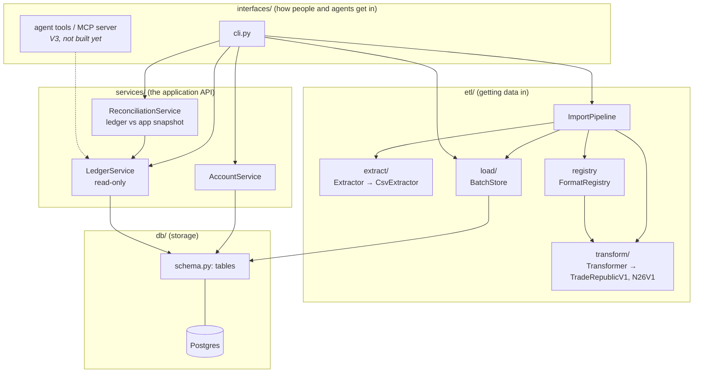
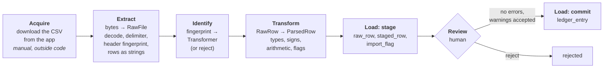
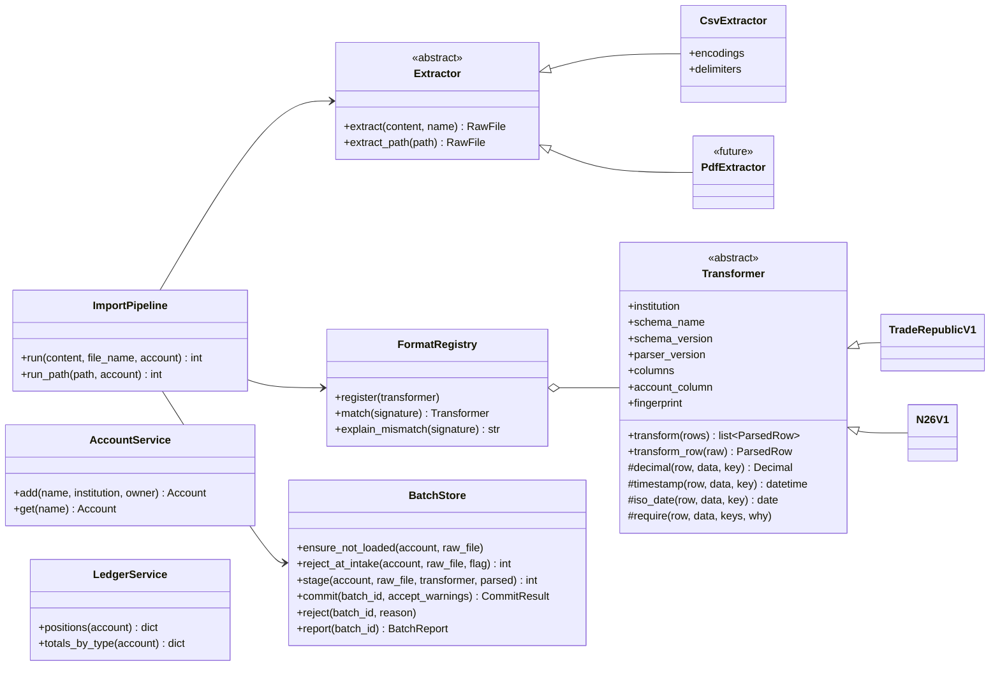
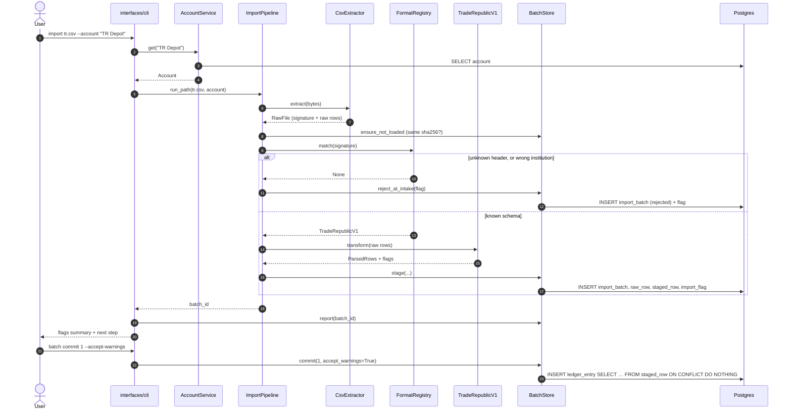

# Architecture

How the modules in `src/our_pocket/` fit together, and where new code goes.
The diagrams are Mermaid: GitHub renders them, and so does VS Code with the
*Markdown Preview Mermaid Support* extension.

## 1. Layers

Dependencies point **down only**. `tests/repo/test_architecture.py` enforces it:

| Package | May import | Must not import |
|---|---|---|
| `interfaces/` | everything below | — |
| `services/` | `etl` (models, registry, load), `db` | `interfaces` |
| `etl/` | `db` (only from `load/`) | `services`, `interfaces` |
| `etl/extract/`, `etl/transform/` | `etl.models` | `db`, `sqlalchemy`, `services`, `interfaces` (they're **pure**) |
| `db/` | `config` | anything above it |

Why this split:

- **`etl/` gets data in. `services/` is the API for using it.** The CLI uses both. Agent tools
  will only use `services/` (`LedgerService`), so they can read the reviewed ledger but never
  reach staging tables or start an import.
- **Extract and transform are pure functions of their input**: no database, no network. They're
  fast to test and can re-run over stored raw rows after a parser fix.
- **`config.py` stays at the top level** because every layer may read settings. **`synthetic/`
  sits beside the layers**, not inside them: it produces test input and nothing in the app
  depends on it.

## 2. ETL, step by step

**Is extraction already done because the CSV is downloaded by hand?** Not quite. The manual
download is **acquisition**: getting the document onto disk. That's done by hand because the
project uses no bank APIs or scraping. **Extraction** is the first step in
code: turning the file's bytes into rows *without interpreting any value*. That covers which
encoding, which delimiter, what the header is, and each cell as the exact string in the file.
Even for a CSV that step can fail (wrong encoding, ragged lines), and its output is what gets
stored losslessly as L1.

**Load happens in two phases** on purpose: staging writes everything plus the flags; committing
moves reviewed rows to the ledger. Between them is the human review step (decision D-006).

## 3. Classes

Data passed between the steps (`etl/models.py`):

| Type | Produced by | Holds |
|---|---|---|
| `RawFile` | Extractor | file name, `FileSignature` (sha256, encoding, delimiter, columns, header fingerprint), `RawRow`s |
| `RawRow` | Extractor | line number + `{column: string}` |
| `ParsedRow` | Transformer | typed fields (dates, Decimals, normalised `entry_type`) + `Flag`s |
| `Flag` | Transformer, pipeline, BatchStore | code, severity (error / warning / info), message, field |
| `Account` | AccountService | the load target: id, name, institution, household |

### Why extractors are per *format* and transformers per *institution*

Trade Republic and N26 both export CSV. A `TradeRepublicExtractor` and an `N26Extractor` would be
the same code twice: decode, find the delimiter, split rows. What differs between institutions is
what the columns **mean**: N26's `Amount (EUR)` vs Trade Republic's `amount` + `fee` + `tax`, their
sign conventions, their type vocabularies. That's transformation. So:

- **Extractor subclasses** = file formats: `CsvExtractor` now, `PdfExtractor` if PDFs come back
  (V2). A PDF extractor would be where an LLM or docling step lives.
- **Transformer subclasses** = one institution at one schema version: `TradeRepublicV1`,
  `N26V1`. When Trade Republic changes its export, `TradeRepublicV2` is added and V1 stays, because
  old batches were read with it.
- The **registry** connects them: the extractor computes the header fingerprint, and the registry
  finds the transformer that declared exactly those columns.

## 4. One import, in sequence

`our-pocket import tr.csv --account "TR Depot"`

**N26:** imported with `--account` like Trade Republic. `N26V1.account_column` is
`"account name"`, so after transforming, the pipeline checks each row's space against the
account's `export_account_name`: another account's space is an `other_account` error, an unknown
one an `unknown_space` warning (D-022).

## 5. Where data lives

Each layer has its own Postgres schema (D-017).

| Layer | Table(s) | Written by | Read by |
|---|---|---|---|
| L0 file | `staging.import_batch` (sha256, signature) | `BatchStore` | audit |
| L1 raw | `raw.raw_row`: append-only, enforced by a trigger | `BatchStore.stage` | re-parsing, audit |
| L2 staged | `staging.staged_row`, `staging.import_flag` | `BatchStore.stage` | review (`batch show`), `commit` |
| L3 ledger | `core.ledger_entry` (accounts also in `core`; `export_account_name` names N26 spaces) | `BatchStore.commit` | `LedgerService` only |

## 6. Adding things

**A new institution (e.g. comdirect):**
1. `etl/transform/comdirect.py`: `class ComdirectV1(Transformer)` with its `institution`,
   `columns` and `transform_row`. Reuse the base helpers (`decimal`, `iso_date`, `require`). Set
   `account_column` if rows name their account, so imports check it.
2. Register it in `etl/registry.py:default_registry()`.
3. `synthetic/comdirect.py`: a seeded generator, with its files in `synthetic.FIXTURES`.
4. Tests: `tests/etl/transform/test_comdirect.py` for its own rules. Add it to each suite in
   `tests/eval/`: ground truth, a planted defect per flag it can raise (a test fails otherwise),
   and its export in the drift cases.

New entry types need a migration that replaces the `ck_ledger_entry_entry_type` CHECK.

**A changed Trade Republic export:** add `TradeRepublicV2` next to V1 (subclass V1 if most logic
carries over) and register both.

**A new file format (PDF):** `etl/extract/pdf_extractor.py: class PdfExtractor(Extractor)`, and the
pipeline picks the extractor by file type. This is where LLM extraction and its evals would go.

**Agent tools (V3):** `interfaces/agent_tools.py` (or an MCP server) exposes `LedgerService`
methods as tools. Tools are read-only and go through services, never through `etl/` or raw SQL.
Row-level security in Postgres then limits each household member to their own rows.

## 7. Module map

| Module | Responsibility |
|---|---|
| `config.py` | Settings from the environment (`DATABASE_URL`) |
| `db/__init__.py` | `get_engine()` |
| `db/schema.py` | All tables (SQLAlchemy Core); Alembic migrations are written from this |
| `etl/models.py` | `Account`, `Flag`, `RawRow`, `ParsedRow`, `ENTRY_FIELDS` |
| `etl/extract/base.py` | `Extractor` ABC, `RawFile`, `FileSignature`, `ExtractionError` |
| `etl/extract/csv_extractor.py` | `CsvExtractor`, `header_fingerprint()` |
| `etl/transform/base.py` | `Transformer` ABC: schema identity, duplicate-ID check, value parsers |
| `etl/transform/trade_republic.py` | `TradeRepublicV1`: column list, type map, sign/arithmetic/FX checks |
| `etl/transform/n26.py` | `N26V1`: column list, type map, content-hash ids, sign/FX checks |
| `etl/transform/validators.py` | ISIN and IBAN check digits |
| `etl/registry.py` | `FormatRegistry`, `default_registry()` |
| `etl/load/batch_store.py` | `BatchStore`: stage / commit / reject / report |
| `etl/pipeline.py` | `ImportPipeline`: extract → identify → transform → check the account → stage |
| `services/accounts.py` | `AccountService`: create and look up accounts |
| `services/ledger.py` | `LedgerService`: read-only queries over the ledger |
| `interfaces/cli.py` | `our-pocket` command line |
| `synthetic/trade_republic.py` | Seeded generator for Trade Republic test exports |
| `synthetic/n26.py` | Seeded generator for N26 exports: three spaces, moves between them, and one-legged moves from another member's space |
